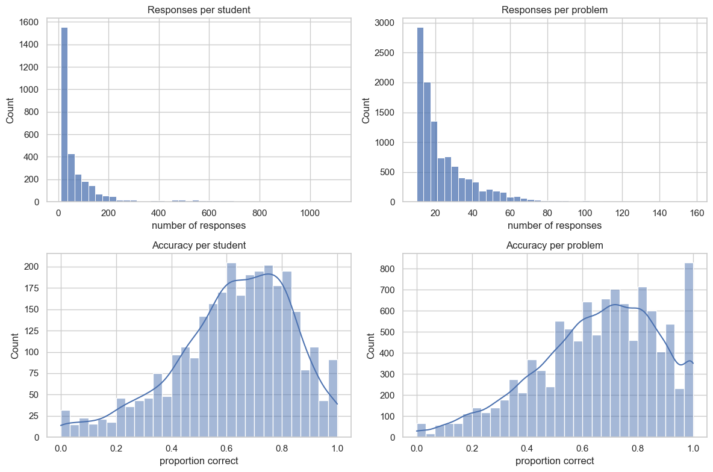
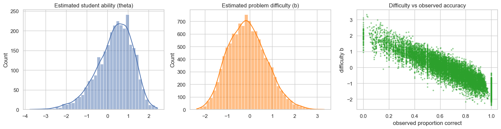
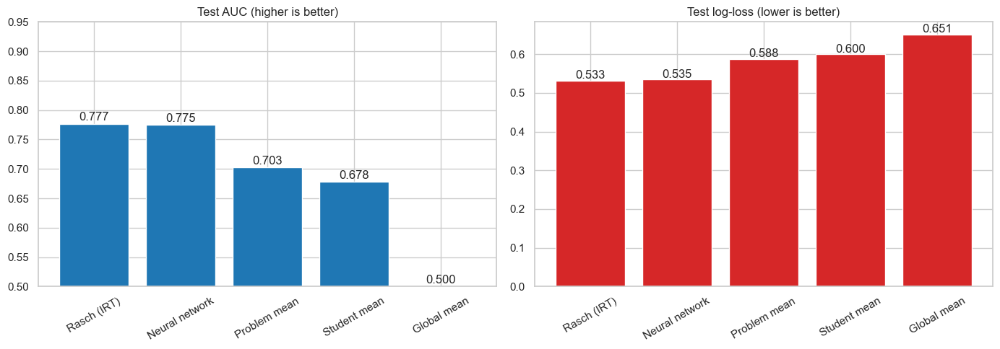
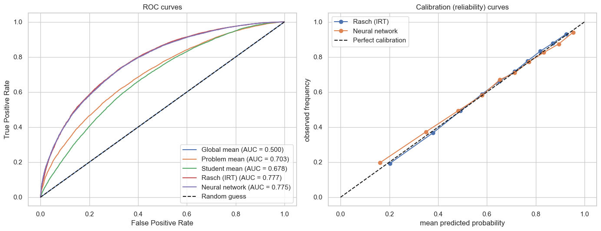
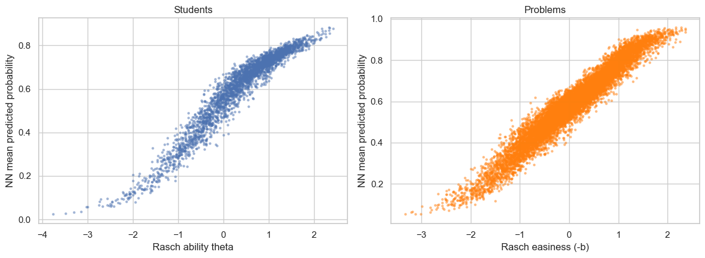

# Predicting Students’ Answers to Math Problems: From Item Response Theory to a Neural Network

*A from-scratch comparison of a classical measurement model from educational psychometrics and a neural network, using real classroom data from an online mathematics tutor.*

**Author:** Naghme Salavatinejad, PhD (Mathematics Education) · salavatinejadn@gmail.com · www.linkedin.com/in/naghme-salavatinejad

---

## In plain words (no machine-learning background needed)

Every time a student answers a math problem, we learn a little about two things at once: how **able** the student is, and how **hard** the problem is. Getting a hard problem right says more than getting an easy one right. **Item Response Theory (IRT)**, a long-standing model in educational measurement, places students and problems on one common scale, so they can be compared fairly even when different students solve different problems.

This project asks a simple question:

> Using only *who answered which problem* and *whether the answer was correct*, how well can we predict a student’s answer to a problem they have not yet been observed on, and does a modern **neural network** predict better than the classical IRT model?

**Short answer.** Not in this dataset. The classical model (the Rasch model, with just one number per student and one per problem) predicts as well as the neural network, within statistical uncertainty, and its numbers can be read directly as “ability” and “difficulty”. The neural network ends up learning essentially the same two scales. For this kind of data, a simple and interpretable measurement model is enough.

Both models were written **from scratch with NumPy**, so the mathematics behind them (gradients, backpropagation, optimisation) is visible and verified, not hidden inside a library.

## At a glance

| | |
|---|---|
| **Data** | ASSISTments 2009–2010 *skill builder*: logs of middle-school students solving math problems online |
| **Size after cleaning** | 271,614 responses · 2,984 students · 10,819 problems · 86 skills · 64.4% correct |
| **Task** | Predict whether a (student, problem) pair is answered correctly on the first attempt |
| **Models** | 3 simple baselines · Rasch model (IRT) · neural network |
| **Best test AUC** | Rasch 0.777 · neural network 0.775 · best baseline 0.703 |
| **Main finding** | The neural network brings no meaningful gain over the Rasch model, and it learns almost the same ability/difficulty scales (Spearman ≈ 0.97) |
| **Educational take-away** | Which problem is asked matters at least as much as who answers it, and an interpretable measurement model is sufficient for first-attempt correctness |

---

## 1. The problem

Teachers and researchers often want to know how difficult each problem is and how strong each student is. But students rarely answer the same problems, so raw percentages are not comparable (a student who only met easy problems looks better than they are). A model that **predicts** answers well must have captured this structure of difficulty and ability, so prediction quality is a practical check on whether the measurement is sound.

## 2. Data

**Source:** ASSISTments 2009–2010 *skill builder* data. Students work on one math skill at a time (for example “Equation Solving Two or Fewer Steps”, “Proportion”, “Pythagorean Theorem”) and continue until they answer **three problems correctly in a row**.

**The raw file is not included in this repository.** Please download it from the ASSISTments data page (search for “ASSISTments data 2009-2010 skill builder”) and read its terms of use.

**Cleaning steps and why they are needed**

| Step | Rows left | Why |
|---|---|---|
| Raw file | 525,534 | |
| Remove duplicated records (`order_id`) | 346,860 | A problem tagged with several skills appears once per skill; one response must count once |
| Keep valid binary responses | 346,860 | The target must be 0 or 1 (no rows were lost here) |
| One response per (student, problem) | 342,081 | A pair seen twice would count the same event twice |
| Keep students and problems with at least 10 responses | **271,614** | Ability or difficulty cannot be estimated from one or two answers |

**What the data look like.** Students answered a median of 35 problems (mean 91, maximum 1,109); problems received a median of 19 responses (mean 25, maximum 158). The student × problem table is only **0.84% filled**: for most pairs we never observe an answer. That is why prediction is a meaningful task: we fill in the gaps from the observed pattern.



## 3. Variables and how they are handled

| Variable | Meaning | Role in the project | Handling |
|---|---|---|---|
| `user_id` | Student identifier | Defines the student *u* | Re-coded to integers 0 … 2,983 |
| `problem_id` | Problem identifier | Defines the problem *i* | Re-coded to integers 0 … 10,818 |
| `correct` | 1 if the first attempt was correct, otherwise 0 | **Target** *y* | Kept as 0/1 |
| `order_id` | Record identifier | Not a model input | Used only to drop duplicated records |
| `skill_name` | Math skill of the problem | Descriptive statistics only | Not used by the models |
| **θ**ᵤ (theta) | Ability of student *u* | **Learned** by the Rasch model | One number per student |
| **b**ᵢ | Difficulty of problem *i* | **Learned** by the Rasch model | One number per problem |
| Embeddings | A learned 16-number “profile” for each student and each problem | **Learned** by the neural network | Combined by the network into a probability |

**Data split.** Responses were randomly divided into **train (70%, 190,129)**, **validation (15%, 40,742)** and **test (15%, 40,743)**. The training part fits the models, the validation part chooses settings (regularisation strength, number of training rounds), and the test part is used only once for the final comparison. Every student and problem in the test set also appears in training, so every prediction uses learned parameters. The share of correct answers is nearly identical in the three parts (64.5%, 64.0%, 64.4%).

## 4. The models

**Baselines (to know what “better than nothing” means)**
- *Global mean:* always predict the overall share of correct answers.
- *Problem mean:* predict each problem’s average success rate.
- *Student mean:* predict each student’s average success rate.

**Rasch model (1-parameter IRT).** The probability that student *u* answers problem *i* correctly is

$$P(\text{correct}) = \sigma(\theta_u - b_i), \qquad \sigma(z)=\frac{1}{1+e^{-z}}$$

Only the **difference** between ability and difficulty matters:

| θ − b | −2 | −1 | 0 | +1 | +2 |
|---|---|---|---|---|---|
| Probability of a correct answer | 12% | 27% | 50% | 73% | 88% |

So a student whose ability equals a problem’s difficulty has a 50% chance; one unit above gives 73%. The numbers θ and b are on a *logit* scale and are relative: they are meaningful as comparisons, not as absolute scores. They are learned by minimising the prediction error (negative log-likelihood) with a small penalty that keeps the numbers from growing too large (L2 regularisation), using **gradient descent** and **Adam**, both written from scratch.



*Left and middle: distributions of the estimated student abilities and problem difficulties. Right: difficulty agrees with what we see in the raw data (problems with a lower observed share of correct answers get higher difficulty), but it also corrects for which students attempted the problem.*

**Neural network.** Each student and each problem gets a learned list of 16 numbers (a “profile”, called an *embedding*). A small network (two hidden layers of 64 and 32 units) combines the two profiles and outputs the probability of a correct answer. It can in principle capture richer patterns than the Rasch model, such as “students strong in *this* kind of problem”. It is trained with **backpropagation** (the chain rule applied layer by layer, derived by hand in the notebook) and **Adam**, with weight decay and early stopping on the validation set.

## 5. How the models are judged

| Metric | What it tells you | Better is |
|---|---|---|
| Accuracy | Share of correct yes/no predictions (threshold 0.5) | higher |
| **Log-loss** | Penalises confident wrong predictions; judges the *probabilities* | lower |
| **AUC** | If we pick one correct and one incorrect answer at random, how often does the model give the correct one a higher probability? 0.5 = chance, 1 = perfect | higher |
| Brier score | Average squared error of the probabilities | lower |
| ECE (calibration error) | Do predicted 70% events really happen about 70% of the time? | lower |

To check whether small differences between two models are real or just noise in one test sample, the notebook uses a **paired bootstrap**: the test responses are resampled 1,000 times and both models are scored on exactly the same resamples. A second, more cautious version resamples **whole students**, because answers by the same student are not independent.

## 6. Results

**Test set (40,743 responses)**

| Model | Log-loss | AUC | Accuracy | Brier | ECE |
|---|---|---|---|---|---|
| **Rasch (IRT)** | **0.5325** | **0.7769** | **0.7361** | **0.1781** | 0.0092 |
| Neural network | 0.5346 | 0.7752 | 0.7342 | 0.1791 | 0.0137 |
| Problem mean | 0.5883 | 0.7031 | 0.6865 | 0.2018 | 0.0063 |
| Student mean | 0.6001 | 0.6784 | 0.6839 | 0.2061 | 0.0071 |
| Global mean | 0.6511 | 0.5000 | 0.6440 | 0.2293 | 0.0007 |



*(The global mean is best calibrated by construction, because it always predicts the same overall rate, but it cannot tell any student or problem apart: AUC 0.5.)*

**Is the Rasch advantage real?** Differences are positive when the Rasch model is better.

| Comparison | Mean difference | 95% interval | Excludes 0? |
|---|---|---|---|
| Log-loss, student-level bootstrap | 0.0021 | [0.0002, 0.0040] | Yes |
| AUC, student-level bootstrap | 0.0018 | [−0.0002, 0.0036] | **No** |
| Log-loss, response-level bootstrap | 0.0021 | [0.0004, 0.0037] | Yes |
| AUC, response-level bootstrap | 0.0018 | [0.0001, 0.0035] | Yes |

Under the cautious student-level version, the Rasch model is *consistently but only marginally* better in log-loss, and the two models cannot be told apart in AUC. In practice the neural network adds nothing.



*Left: ROC curves (the Rasch and neural-network curves almost coincide). Right: both models’ predicted probabilities match observed frequencies closely.*

**Other findings**
- **Problem difficulty is more informative than student ability alone** (AUC 0.703 vs 0.678), but the two together are clearly best (0.777).
- **By how much a student has practised:** the neural network is slightly worse for students with up to 60 training responses and equal for students with more than 60 (AUC 0.777 vs 0.777). Its extra flexibility does not help even where data are scarce.
- **The network learned the same scales as IRT.** Averaging its predictions over a common set of problems gives a student “score” that correlates with the Rasch ability at Spearman ρ = **0.967**; for problems the correlation with Rasch easiness is **0.971**.



- The neural network reached its best validation loss after only 3 training rounds. With about 25 responses per problem, there is little for a flexible model to learn beyond what the Rasch model already captures.

## 7. What this means for mathematics education

1. **Which problem is asked matters as much as who answers it.** Knowing only a problem’s average success rate predicts better than knowing only a student’s. Interpreting a student’s percentage correct without considering how hard their problems were can be misleading.
2. **A transparent measurement model is enough for this kind of data.** The Rasch model predicts first-attempt correctness as well as a neural network, and its parameters can be explained to teachers: a difficulty for every problem and an ability for every student on one shared scale. Nothing is gained by moving to a black box here.
3. **The learnable structure is essentially one-dimensional in these data.** Even a flexible network recovered the same ability and difficulty scales (ρ ≈ 0.97). This says something about *right/wrong first attempts in these skill-builder sets*. It does not say that mathematical thinking is one-dimensional.
4. **Right/wrong data cannot explain *why*.** The models say nothing about which strategies, representations or misconceptions lie behind an answer, nor about whether the tutoring worked. Answering such questions needs richer, process-level data (see section 11).

## 8. Can the code be trusted? (verification)

| Check | Result |
|---|---|
| Analytic vs numerical gradient, Rasch model | maximum relative error 4.8 × 10⁻⁹ |
| Analytic vs numerical gradient, neural network (every parameter) | maximum relative error 2.8 × 10⁻⁶ |
| Recovering known parameters from simulated data | correlation 0.976 (ability) and 0.993 (difficulty) |
| Comparison with scikit-learn logistic regression (same objective) | mean difference in predicted probability 10⁻⁵; same test AUC (0.7769) |
| Gradient descent (step size 1/L) vs Adam | the same validation loss (0.5371) |

scikit-learn is used only for evaluation metrics and for these verification checks; all training code is NumPy.

## 9. Limitations

- **The missing answers are not random.** In skill-builder sets a student stops after three correct answers in a row, so which problems a student sees depends on past performance. Both models ignore this.
- **Ability is treated as fixed.** The models do not describe learning over time (Knowledge Tracing models do).
- **No new students or problems.** Everyone and every problem must appear in the training data.
- **Only first-attempt correctness** is modelled: hints, response time and the skill structure are not used.
- **One random split.** The bootstrap quantifies test-sample noise, but not the effect of a different split.
- **Prediction is not explanation.** Nothing here shows why a problem is hard or whether a teaching approach works.

## 10. How to run it

**Requirements:** Python 3.9 or newer and the packages in `requirements.txt` (NumPy, pandas, SciPy, Matplotlib, Seaborn, scikit-learn, Jupyter).

```bash
pip install -r requirements.txt
jupyter notebook irt_vs_neural_network.ipynb
```

1. Download the ASSISTments 2009–2010 skill-builder csv file and put it in a folder named `data/` next to the notebook. (The notebook finds files with `skill_builder` in their name; otherwise set `DATA_PATH` in the configuration cell.)
2. Choose **Kernel → Restart & Run All**. The whole notebook runs in a few minutes on a laptop CPU.
3. Settings (random seed 42, minimum 10 responses per student and per problem, 70/15/15 split) are at the top of the notebook. Results can differ very slightly across library versions.

**Repository structure**

```
.
├── irt_vs_neural_network.ipynb   # Full analysis: maths, implementation, experiments, discussion
├── README.md
├── requirements.txt
├── figures/                      # Figures used in this README (produced by the notebook)
└── data/                         # Put the downloaded csv here (not tracked)
```

**Where to look in the notebook**

| Sections | Content |
|---|---|
| 3–4 | Mathematical tools, Rasch model, gradient and recovery checks |
| 5–7 | Data loading and cleaning, exploratory analysis, split and baselines |
| 8 | Training the Rasch model, comparison with scikit-learn |
| 9 | Neural network: forward and backward pass, gradient check, training |
| 10–11 | Final comparison, bootstrap, error analysis |
| 12–13 | Discussion, limitations and educational conclusions |

## 11. How this relates to my research interests

My doctoral research studied how students think about combinatorics, building a qualitative model of their thinking (Salavatinejad, Alamolhodaei & Radmehr, 2021). This project shows the complementary side: what **quantitative measurement** can and cannot say about mathematical learning. Right/wrong data identify *how hard* a problem is and *how able* a student is, but not *how* a student thinks. A natural next step is to combine IRT-style measurement with process-level information (strategies, representations, solution steps).

**Possible extensions:** 2PL/3PL IRT models, using the skill information, Knowledge Tracing models (for example an LSTM in PyTorch), temporal splits, and repeated splits for more robust comparisons.

## Glossary

<details>
<summary>Click to open</summary>

- **Ability (θ) and difficulty (b):** numbers on a shared scale; higher ability or lower difficulty means a higher chance of a correct answer.
- **Logit:** log of the odds of success, p/(1 − p); the scale on which θ and b live.
- **Regularisation (L2):** a penalty that prevents parameters from becoming extreme when data are scarce.
- **Gradient descent / Adam:** step-by-step methods that adjust parameters in the direction that reduces the prediction error.
- **Embedding:** a learned list of numbers describing a student or a problem.
- **Backpropagation:** the chain rule used to compute how each network parameter affects the error.
- **Overfitting / early stopping:** a model memorises noise in the training data; stopping training when validation error stops improving prevents it.
- **Calibration:** whether predicted probabilities match observed frequencies.
- **Bootstrap:** resampling the test data many times to see how much a result would vary by chance.

</details>

## Data reference

Feng, M., Heffernan, N., & Koedinger, K. (2009). Addressing the assessment challenge with an online system that tutors as it assesses. *User Modeling and User-Adapted Interaction, 19*(3), 243–266.

Salavatinejad, N., Alamolhodaei, H., & Radmehr, F. (2021). Toward a model for students’ combinatorial thinking. *The Journal of Mathematical Behavior, 61*, 100823. https://doi.org/10.1016/j.jmathb.2020.100823
